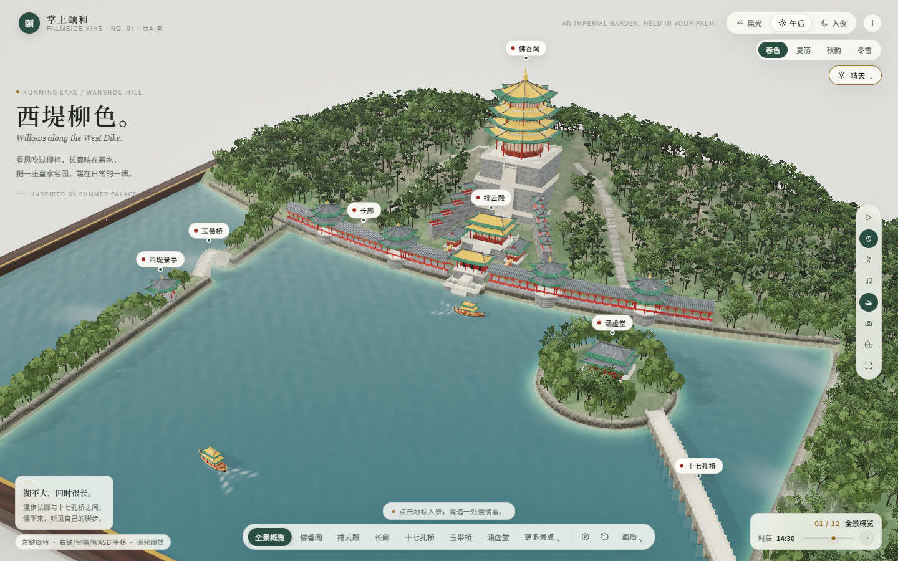
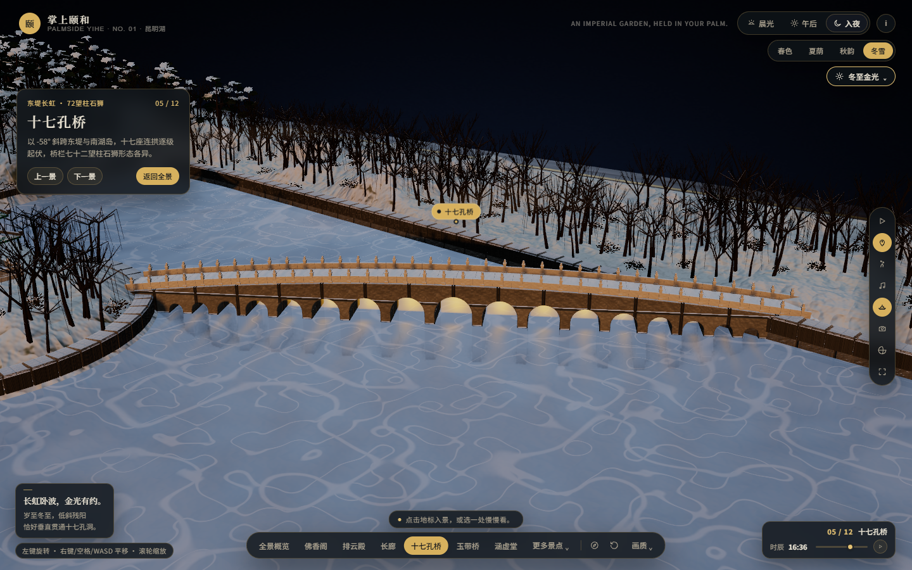
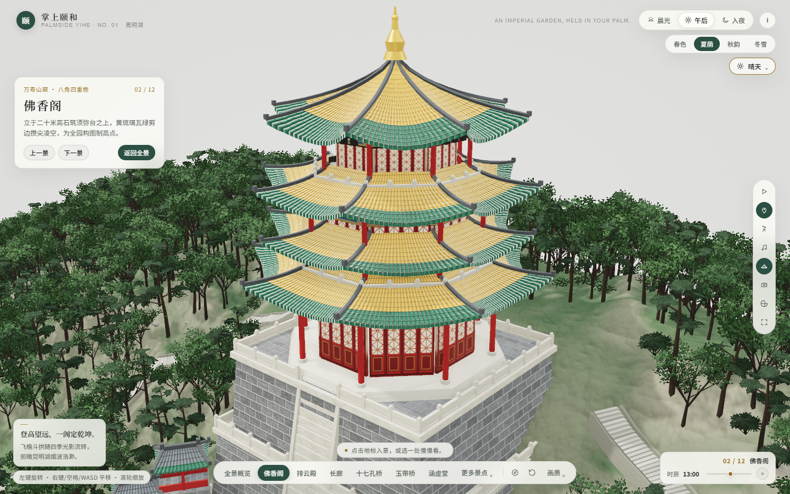
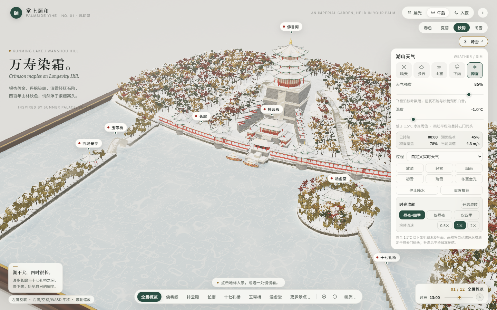
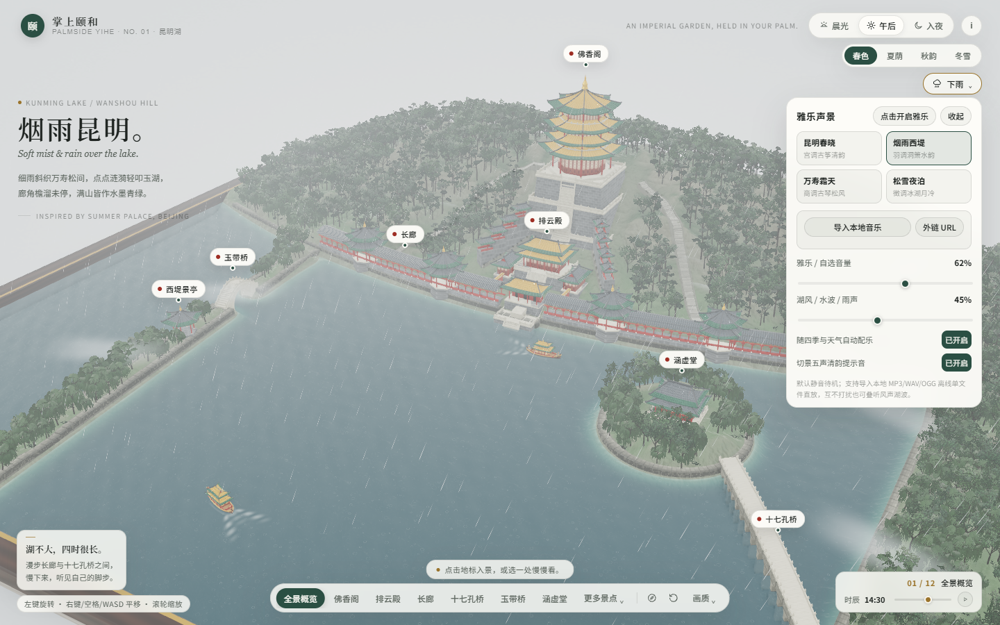

# 掌上颐和 · Palmside Yihe

> 一方紫檀嵌金托盘，半部清代皇家山水 —— **100% 零外部资产、纯程序化生成的高精度 3D 新中式微缩颐和园沙盘。**

全项目基于 **TypeScript + Three.js (WebGL2) + Vite 6 + 原生 Web Audio API** 构建：**零外部 `.glb` 模型、零外部纹理图片、零外部音频/字体 CDN、零运行时 `fetch`**，单文件离线产物 `dist-single/index.html` 仅 **`0.78 MB`**。

---

## 实景渲染效果

### 1. 春季宣纸全景 · 7 枚碰撞避让 3D 景点标注


### 2. 冬至金光穿洞 · 变换视角显现 + 17 孔闭式反解精准倒影（暗墨鎏金主题）


<details>
<summary>展开更多季节与交互界面截图（夏荫佛香阁 / 秋韵天气面板 / 烟雨雅乐面板）</summary>

#### 佛香阁四重檐夏荫特写与分景导览卡


#### 万寿染霜降雪与「湖山天气 / 时光流转」面板


#### 烟雨昆明与「雅乐声景」自定义换歌面板


</details>

---

## 核心特性

- **100% 纯程序化古建与地形建模**
  - **佛香阁与排云殿中轴建筑群**：八角四重檐攒尖顶（黄琉璃瓦绿剪边）、须弥石台、八字御道斜廊及码头泊港。
  - **无扭曲苏式彩画长廊**：4 座八角重檐景亭串联蜿蜒长廊，全程序化绘制包袱彩画与倒挂楣子。
  - **十七孔桥与西堤玉带桥**：`-58°` 物理镂空 17 孔联拱桥（逐孔递减半径 + 72 根望柱石狮），汉白玉高拱单孔玉带桥含 28 级实砌弧阶；另有西堤六角景亭、南湖岛涵虚堂与 420 级依山青石古径。
  - **2,000 株多级分枝四季林海**：256×256 程序化枝叶簇贴图 + 同步风摆 `customDepthMaterial`，支持春花、夏荫、秋枫银杏、冬雪枯枝无缝过渡。
- **物理光影与冬至「变换视角见金光」光学引擎**
  - WebGL2 4×MSAA 离屏 `EffectComposer`（`RenderPass → 半分辨率 GTAOPass → OutputPass`）配合双主题 4 软箱 PMREM 环境烘焙。
  - **冬至 9.0° 低斜晚照**：通过内置视向光学对齐窗（水平 `-58°` 轴线 × 低仰角掠射 × 交叉面片侧视消隐），正对桥洞低俯时显现温润琥珀金光穿洞，斜侧或拉高俯瞰时自然隐退；湖面采用 `0.98k - 0.03k²` 闭式反解使 17 道金波倒影与全部 17 座物理桥孔 1:1 精准对位。
- **全解耦「季节 × 天气 × 24h 昼夜」与时光流转**
  - 季节（春/夏/秋/冬）、天气（晴/多云/山雾/下雨/降雪）、温度（低于 `1.5°C` 渐凝冰裂纹，两艘龙首画舫自动减速泊定排云门码头，升温后解冻复航）及 24 小时昼夜光照完全解耦；支持一键开启「昼夜+四季 / 仅昼夜 / 仅四季」`0.5× / 1× / 2×` 自动演替。
- **新中式双主题展陈 HUD 与 12 景点沉浸巡游**
  - 支持宣纸浅色（`xuan-light`）与暗墨鎏金（`ink-gold`）双主题切换，12 处可访景点、低空石阶漫游、360° 缓速环绕展陈及 PNG 高清留影。
- **原生 Web Audio 雅乐声景引擎**
  - 内置 4 首五声调式程序化古韵曲目（古筝/洞箫/古琴），随海拔、风速、冰期与雨势联动混音；默认静音待机，支持导入本地 `MP3 / WAV / OGG` 音乐或粘贴音频直链。

---

## 交互操作指南

| 操作 | 触发方式 |
| :--- | :--- |
| **旋转视角** | 鼠标左键拖拽（或单指滑动） |
| **水平平移** | 右键拖拽 / 中键拖拽 / 按住 `Space` + 左键拖拽 / `WASD` 或方向键 |
| **缩放焦距** | 鼠标滚轮 / 双指捏合 |
| **分景游览** | 点击沙盘悬浮标注、底部景点胶囊，或右侧栏切换景点 / 漫游 / 360° 环绕 |
| **时光流转** | 点击右下角播放钮或天气面板内「时光流转」开关 |

---

## 本地开发与构建

> 环境要求：**Node.js >= 18.0.0**

```bash
# 1. 安装依赖
npm install

# 2. 启动本地开发服务器
npm run dev

# 3. TypeScript 类型检查
npm run typecheck

# 4. 标准多文件生产构建（输出至 dist/，适合 GitHub Pages / 静态托管）
npm run build

# 5. 单文件离线包构建（输出至 dist-single/index.html，约 0.78 MB，可直接双击本地打开）
npm run build:single

# 6. 本地预览生产构建
npm run preview
```

### 自动化视觉与 E2E 门禁（Playwright）

若需复现 8 机位渲染截图对比、DrawCall 统计与交互状态断言：

```bash
npm run build
npm run verify -- --milestone=m5
```

截图结果输出至 `artifacts/` 目录（默认已被 `.gitignore` 忽略）。

---

## GitHub Pages 一键发布与离线 Release

仓库已预置全套 `.github/workflows/` 工作流（无需手动配置构建命令）：

1. **开启在线预览（GitHub Pages）**
   - 将仓库推送到 GitHub `main` 分支后，打开仓库 **`Settings → Pages`**。
   - 在 **`Build and deployment → Source`** 下拉选择 **`GitHub Actions`**。
   - 后续每次推送至 `main` 或手动触发 `Deploy to GitHub Pages` 工作流，即自动完成类型检查、构建并部署上线。
2. **发布离线单文件版（GitHub Release）**
   - 推送任意 `v*` 标签（例如 `git tag v2.1.0 && git push origin v2.1.0`）。
   - `Release Offline Single-File` 工作流会自动编译单文件离线版 `palmside-yihe-offline.html` 并附带生成 Release 下载页面；CI 每次构建也会在 Artifacts 中保留 `palmside-yihe-offline-singlefile`。

---

## 项目结构

```text
palmside-yihe/
├── .github/
│   ├── ISSUE_TEMPLATE/          # Bug 反馈与功能建议模板
│   └── workflows/
│       ├── ci.yml               # main 分支 PR/Push 类型检查、构建与离线单文件 Artifact
│       ├── deploy-pages.yml     # GitHub Pages 自动部署
│       └── release.yml          # v* 标签自动打包并发布离线单文件 Release
├── docs/screenshots/            # README 展示高清实景截图（5 张）
├── scripts/
│   ├── build-single.mjs         # 单文件自包含产物编译与 3.0 MB 红线检查
│   └── verify-visuals.mjs       # Playwright 8 机位 + E2E 交互自动化核验
├── src/
│   ├── audio/                   # Web Audio 程序化古韵声景与本地换歌引擎
│   ├── config/                  # 场景常数、四季参数预设与全局响应式状态
│   ├── core/                    # 4×MSAA + GTAO 管线、着色器增强、相机台架与地形数学
│   ├── generators/              # 佛香阁、长廊、十七孔桥、玉带桥、林海与展台生成器
│   ├── textures/                # 100% Canvas/TypedArray 程序化 PBR 与苏式彩画纹理
│   ├── ui/                      # 新中式双主题展陈 HUD 与 3D-to-2D 避让标注层
│   ├── world/                   # 画舫四态冰期航行器与山雾/雨雪/冬至金光系统
│   └── main.ts                  # 主循环、天时气候解耦求解与调试接口
├── index.html                   # 入口 HTML 与 WebGL2 降级提示
├── vite.config.ts               # 双模式 Vite 配置（dist 分包 / SINGLE_FILE 单文件）
├── PRD_v2.1.md                  # 全工程设计规格书与视觉门禁红线
├── CHANGELOG.md                 # 版本更新日志
└── LICENSE                      # MIT 开源协议
```

---

## 性能与体积实测指标

| 指标 | 实测结果 | 门禁上限 |
| :--- | :--- | :--- |
| 主场景全视角 DrawCall | **`63 – 69`**（含冬至 17 道体积金光合并单 DrawCall） | `<= 75` |
| 单文件离线 HTML 产物 (`dist-single/index.html`) | **`813,409 bytes (0.776 MB)`** | `<= 3.000 MB` |
| 外部资源 / 运行时 `fetch` 依赖 | **`0`** | `0` |

---

## 开源协议

本项目采用 [MIT License](LICENSE) 开源。
